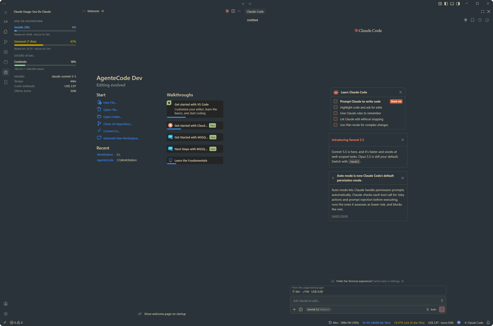
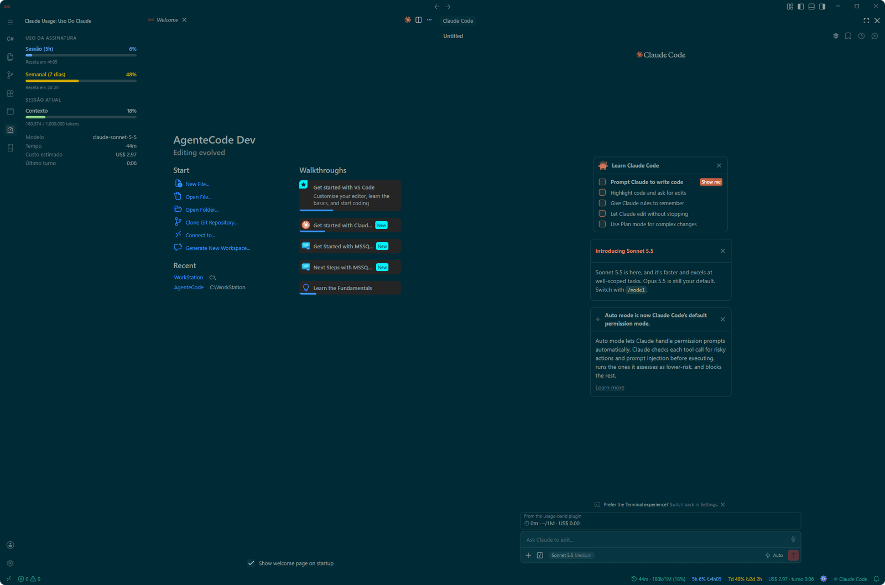
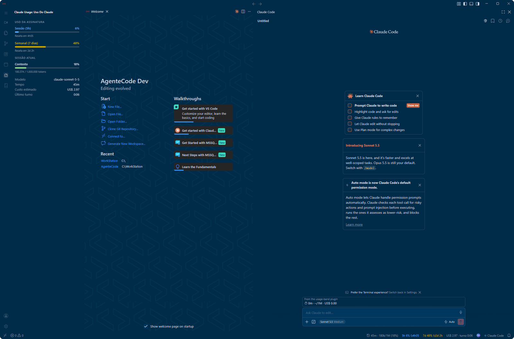
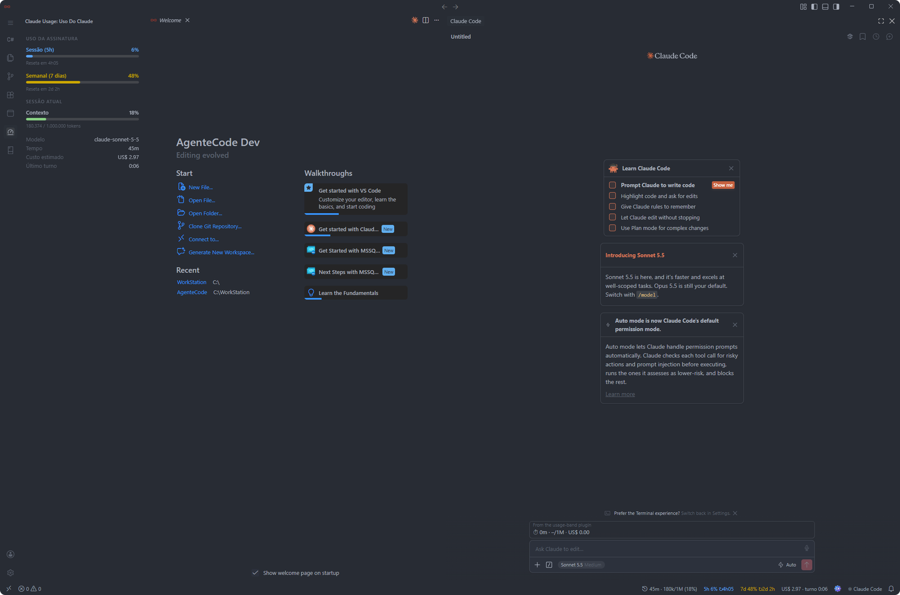
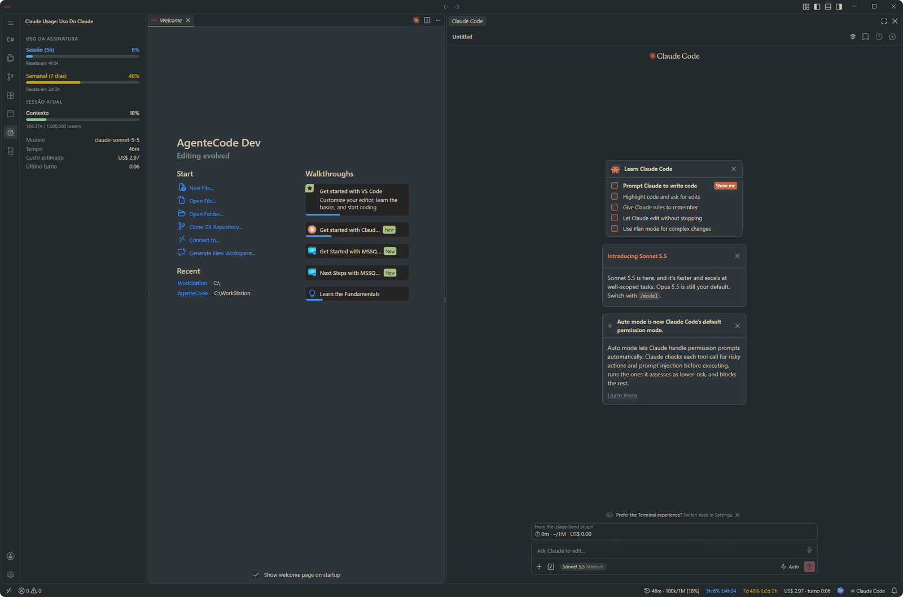
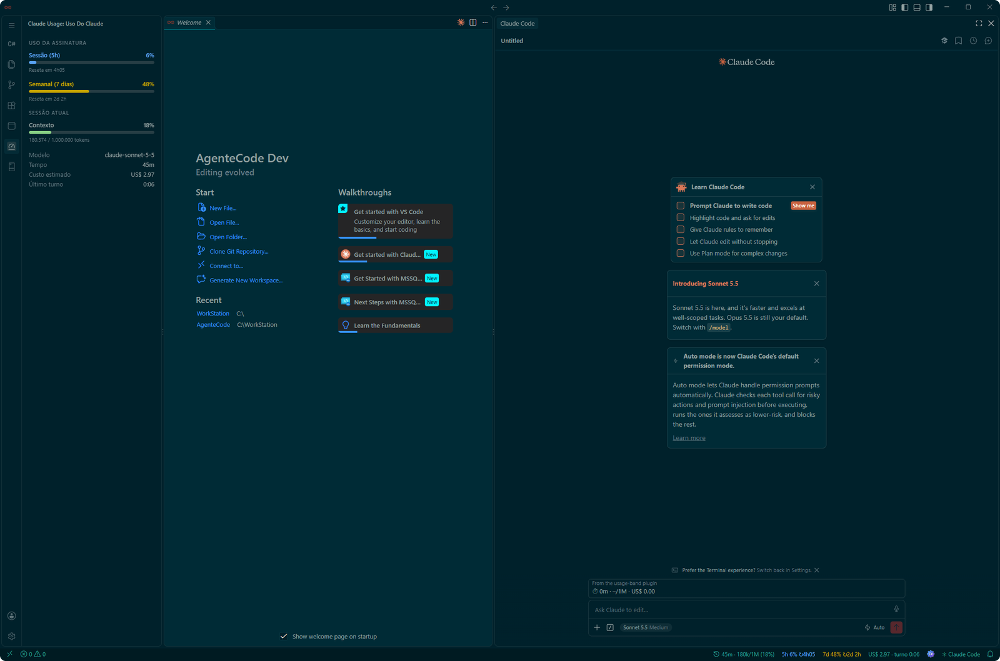
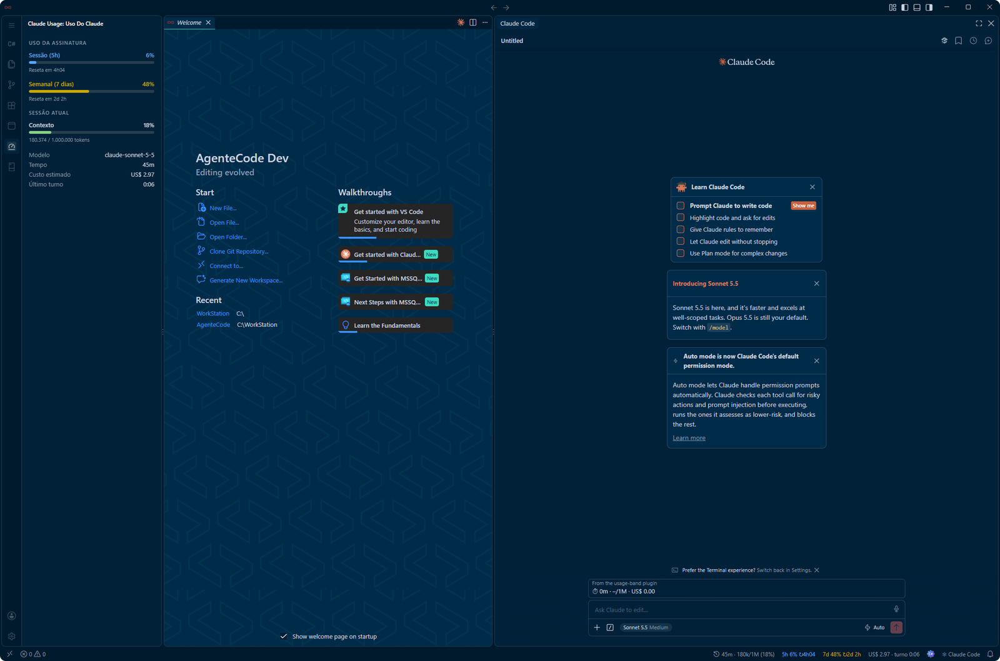
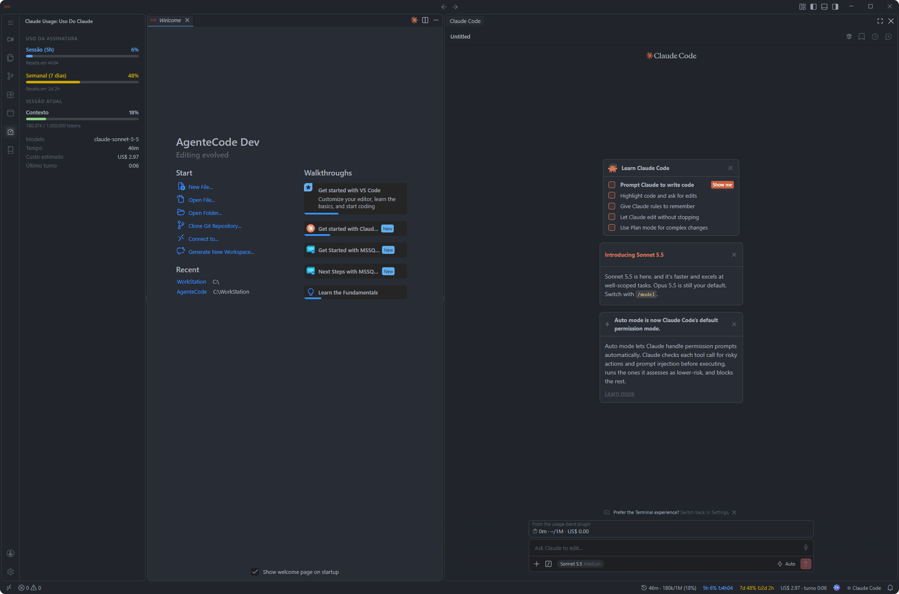

<p align="center">
  <picture>
    <source media="(prefers-color-scheme: dark)" srcset="resources/readme/logo-dark.svg">
    
  </picture>
</p>

<p align="center">
  <strong>The AI-First IDE for Autonomous Engineering</strong><br>
  Uma distribuição moderna, veloz e focada em pair programming agêntico, com interface sem bordas e máxima produtividade.
</p>

<p align="center">
  
  
  
  
  
</p>



---

## 🚀 Sobre o AgenteCode

O **AgenteCode** é uma IDE de alta performance criada para a era dos **agentes autônomos de IA**. Construído a partir do núcleo aberto do **Code - OSS**, elimina camadas proprietárias desnecessárias, telemetria invasiva e pop-ups comerciais, entregando uma experiência limpa, sem divisórias visuais e com integração nativa ao **Claude Code**.

---

## ✨ Principais Diferenciais

### 🧠 Claude Code Integrado de Fábrica
- Painel lateral dedicado posicionado na barra lateral secundária (**Right Auxiliary Bar**), garantindo que seu explorador de arquivos e estrutura de projeto fiquem sempre visíveis à esquerda.
- Atalho nativo **`Ctrl + L`**: Pressione para abrir instantaneamente o chat com o agente; pressione novamente para recolher o painel (*toggle* completo).
- Eliminação total de chatbots redundantes ou popups de cota — foco exclusivo no agente principal.

### 🎨 Experiência Seamless Canvas (Borderless)
- Interface fluida e sem divisórias: eliminação de linhas divisórias pesadas e pontos de redimensionamento (`sash grips`).
- Editor de código, barras laterais e terminal compõem uma superfície visual única, contínua e imersiva.

### 📐 Activity Bar Ergonômica
- Dimensões calibradas para **42px de largura e altura** (contra os 48px convencionais).
- Ícones em **18px** com indicadores arredondados em caixa de destaque suave (*soft rounded box*), trazendo máxima elegância e aproveitamento de tela.

### ⚡ Zero Bloatware & Alta Performance
- **Desativação de Daemons Ocultos:** Inicialização de processos em segundo plano (`AgentHost` e `RemoteAgentHost`) completamente neutralizada.
- **Fim de Telas Promocionais:** Removidas notificações de cotas, pesquisas de conta Microsoft e banners comerciais.
- Consumo de memória e processamento reduzido para inicialização instantânea.

### 🎨 Suíte de 8 Temas Nativos Oficiais
- **AgenteCode Eficaz & Eficaz Clean:** Paleta corporativa oficial EF Sistemas (Azul Petróleo `#002B49`, Verde-Água `#3CDBC0` e Slate Blue `#869CAE`).
- **AgenteCode Deep Teal & Deep Teal Clean:** Fundo escuro esmeralda focado em leitura de código.
- **AgenteCode Everforest & Everforest Clean:** Tons orgânicos suaves de alto contraste e baixo cansaço visual.
- **AgenteCode One Dark Pro & One Dark Pro Clean:** O consagrado clássico dark perfeitamente ajustado para a estética borderless.

### 🛠️ Built-in Power Suite (Extensões Pré-instaladas)
O AgenteCode já vem pronto para o trabalho do dia a dia, com extensões integradas:
- **C# Dev Tools** (`jakubkozera.csharp-dev-tools`): Ferramentas completas para C# e .NET.
- **.NET Install Tool** (`ms-dotnettools.vscode-dotnet-runtime`): Aquisição e gestão do runtime .NET.
- **Claude Code for VS Code** (`anthropic.claude-code`): O agente líder de codificação pareada.
- **Claude Usage: Limits, Context & Cost** (`alessandrolobo.claude-usage-statusbar-metric`): Monitoramento em tempo real de tokens, custos e limites na barra de status.
- **Markhub** (`HellFiveOsborn.markhub`): Editor rico de Markdown com suporte nativo a diagramas Mermaid.
- **SQL Server (mssql)** (`ms-mssql.mssql`): Conexão e consultas a bancos de dados Microsoft SQL Server e Azure SQL.

### 📦 Marketplace Livre (Open VSX)
- Conexão configurada diretamente para a **Open VSX Gallery** (`open-vsx.org`), permitindo instalar livremente milhares de extensões comunitárias sem violar termos proprietários.

---

## 🎨 Galeria de Temas

Quatro paletas, cada uma com variante **normal** (painéis com tons distintos) e **Clean** (superfície única, sem divisórias).

### Variantes Clean

| | |
|:---:|:---:|
| <br>**Everforest Clean** | <br>**Deep Teal Clean** |
| <br>**AgenteCode Eficaz Clean** | <br>**One Dark Pro Clean** |

### Variantes normais

| | |
|:---:|:---:|
| <br>**Everforest** | <br>**Deep Teal** |
| <br>**AgenteCode Eficaz** | <br>**One Dark Pro** |

---

## ⌨️ Atalhos Principais

| Atalho | Ação |
| :--- | :--- |
| **`Ctrl + L`** | Abrir / Recolher o Claude Code (Toggle Lateral) |
| **`Ctrl + Shift + P`** | Abrir Paleta de Comandos Global |
| **`Ctrl + P`** | Localização Rápida de Arquivos |
| **`Ctrl + B`** | Alternar Barra Lateral Primária (Explorador) |
| **`Ctrl + J`** | Alternar Painel Inferior (Terminal / Problemas) |
| **`Ctrl + K Ctrl + T`** | Seletor de Temas Nativos Oficiais |

---

## 💻 Como Compilar e Rodar a partir do Código-Fonte

### Pré-requisitos
- **Node.js:** Versão `24.20.0` (recomendado uso do `.nvmrc`).
- **Python:** Versão `3.12+` (com ferramentas `setuptools`).
- **Visual Studio Build Tools:** C++ Desktop Development com bibliotecas com mitigação Spectre.
- **Git:** Com suporte a caminhos longos ativado (`git config --global core.longpaths true`).

### Passo a Passo

1. **Clonar o Repositório:**
   ```bash
   git clone https://github.com/agentecode/agentecode.git
   cd agentecode/core
   ```

2. **Instalar Dependências:**
   ```bash
   npm install
   ```

3. **Compilar os Recursos do Cliente:**
   ```bash
   npm run transpile-client
   ```

4. **Iniciar o AgenteCode em Modo de Desenvolvimento:**
   ```powershell
   .\scripts\code.bat
   ```

---

## 📦 Distribuição e Download

- **Instalador Oficial para Windows (x64):** Baixe o executável `AgenteCodeSetup-x64.exe` na página de [Releases](https://github.com/agentecode/agentecode/releases).
- **Página Oficial do Projeto:** [agentecode.github.io](https://agentecode.github.io)

---

## 📄 Licença e Créditos

O **AgenteCode** é distribuído sob a licença [MIT](LICENSE.txt).

- Baseado no projeto de código aberto **Code - OSS** da Microsoft Corporation.
- O AgenteCode é um projeto independente mantido por Alessandro Lobo e não é patrocinado nem afiliado à Microsoft Corporation.
